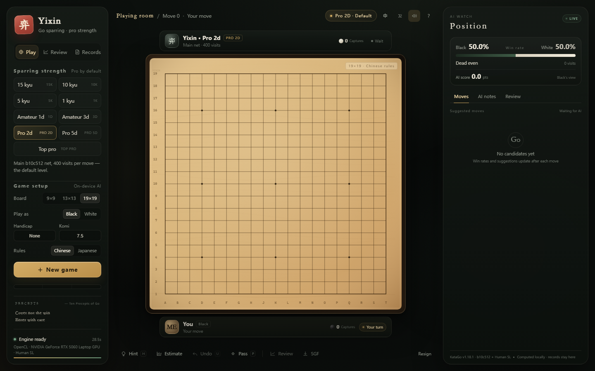
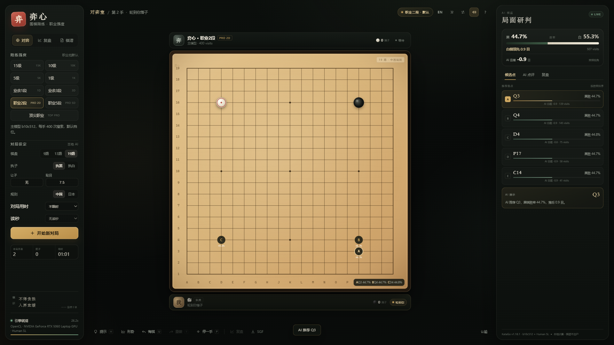
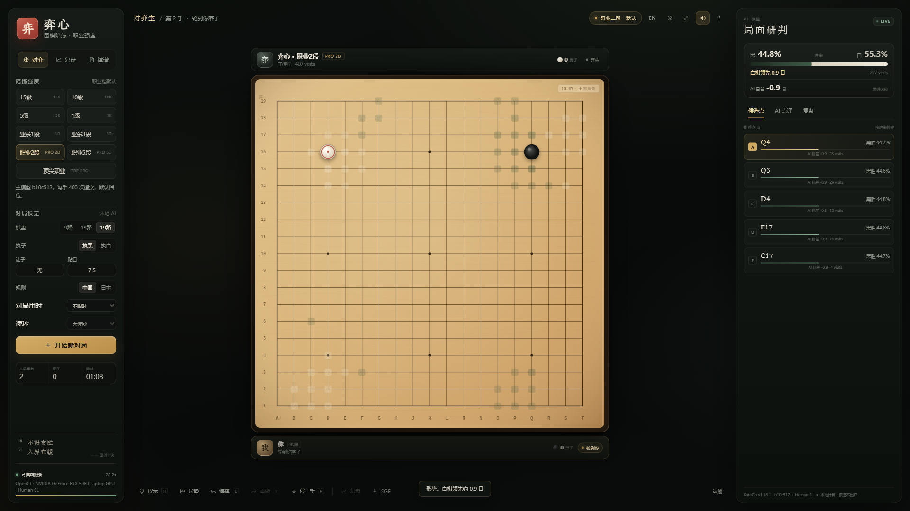

# Yixin · Go Sparring (弈心 · 围棋陪练)

**A local-first Go sparring partner for Windows: open a browser, play KataGo. No account, no cloud, no setup.**

Every move is a live MCTS search on your own GPU — not a scripted game record, not a cloud API.

  
  
  
  

Real screenshots (Windows 11 / RTX 5060 Laptop / OpenCL): 19×19, default "2d pro" level (b10c512, 400 visits per move). The last two show AI hints (A/B/C candidates) and the position estimate. The UI toggles between Chinese and English; <code>?lang=en</code> opens it directly in English.

---

## What this is

A Windows desktop app that puts a Go board in your browser and a KataGo analysis engine behind it. The backend is pure Python stdlib; the frontend is a hand-drawn Canvas board with zero frameworks and zero CDN assets.

It exists for one narrow use case: **you want to play a game or review one right now, locally, without registering anywhere or configuring an engine path.**

It is not trying to be Sabaki, KaTrain or Lizzie. Those are far more capable as editors and analysis workbenches. This is the "double-click and play" path:

- free online Go AI platforms limit games or charge subscriptions;
- open-source GUI + engine combos are powerful but need Python, weights and config wrangling;
- uploading your game records to review them feels unnecessary.

## Quick start (60 seconds)

1. Grab `Yixin-Go-Sparring-*-portable.zip` from [Releases](https://github.com/Qin-Z-x/yixin-go/releases/latest) and extract it anywhere **without non-ASCII characters in the path** (avoid `Program Files` too).
2. Double-click `启动围棋陪练.bat` ("start Go sparring").
3. Wait 10–30 s for GPU warm-up; Edge opens as an app window with the board.

Default: you play Black, 19×19, Chinese rules. The AI answers automatically.

**From source:** Python 3.10+ and a local KataGo build — see [docs/BUILD.md](docs/BUILD.md).

## Strength levels

| Level | Engine setup | Who it's for |
| --- | --- | --- |
| 15k / 10k / 5k / 1k | b18 Human SL | Beginners to intermediate: samples from human move distributions instead of engine-only moves |
| 1d / 3d (amateur) | b18 Human SL | Players with some rank who want midgame and endgame practice |
| **2d pro (default)** | b10c512, 400 visits | A daily sparring partner that pushes you |
| 5d pro | b10c512, 800 visits | Complex fights and life-and-death |
| Top pro | b10c512, 1600 visits | Roughly KataGo's practical strength; use it to measure the gap |

Important, so nobody is misled:

- These are **configuration names**, not certificates. A level is a (model, visits) pair; every move is searched live.
- The mapping from visits to playing strength follows KataGo's own guidance. If you need an actual rating, use KataGo's official rating tools or a sanctioned evaluation. A level label in this app is not a rank certificate.
- Speed depends on your GPU. On the author's RTX 5060 Laptop with OpenCL: ~2–4 s/move at 400 visits, ~4–7 s at 800, ~8–15 s at 1600. Integrated GPUs are much slower.

## Features

- **Play**: 19/13/9 boards, Chinese/Japanese rules, Black or White, 2–9 handicap stones, adjustable komi.
- **AI hints**: press `H` for three candidate moves (A/B/C) with winrate, score lead and variation trees.
- **Position judgement**: toggle KataGo's territory ownership and score prediction.
- **Dead-stone marking**: after both sides pass, dead stones are proposed automatically; click to correct, then confirm to score.
- **Per-move review**: winrate-loss curve, good moves and blunders, KataGo's preferred move and variations; click the curve or move list to jump.
- **SGF**: export at any time; finished games are auto-saved to `data/games/`.
- **Fully offline**: no requests leave your machine.

## How it compares

| | Yixin | Online Go AI services | Sabaki / Lizzie / KaTrain |
| --- | --- | --- | --- |
| Runtime | local exe + browser UI | website | local desktop app |
| Playable AI out of the box | ✅ | ✅ but limited/paid | ⚠️ configure an engine yourself |
| Hints / judgement / review | ✅ same engine | partial | ✅ but needs setup |
| Human-like strength levels | ✅ 6 levels (Human SL) | rare | rare |
| Account / network required | ❌ | ✅ | ❌ |
| License | MIT | proprietary | mostly MIT/GPL |

## Keyboard

| Key | Action |
| --- | --- |
| `H` | AI hint (A/B/C candidates) |
| `U` | Undo |
| `P` | Pass |
| `Esc` | Close dialog |

## Technical notes

- Backend: Python stdlib `ThreadingHTTPServer`, no web framework, no third-party dependencies.
- Engine: KataGo `analysis` JSON protocol over OpenCL; main net and Human SL net loaded side by side, switched per level.
- Frontend: raw Canvas, high-DPI aware, procedurally generated board texture and stones — no images, no CDN, no web fonts.
- Concurrency: play, pre-analysis, review and scoring run on separate threads with a priority queue inside the engine wrapper, so review never blocks the current game.
- Rules: Chinese area scoring, Japanese territory + captures; handicap games get no extra compensation for White.

## Requirements

- Windows 10 / 11 (x64).
- An OpenCL-capable GPU (NVIDIA dGPU preferred; AMD and Intel iGPUs work but are slower).
- ~250 MB of disk including the engine and both networks.

## FAQ

**Slow first start?** KataGo tunes OpenCL kernels for each model once, caching into `engine/katago-opencl/KataGoData/opencltuning/`. Later starts take ~15 s.

**"Engine error"?** Run `调试启动.bat` ("debug start") and read the console. Usual causes: GPU memory exhausted, antivirus blocking `katago.exe`, incomplete model files. Click the engine card in the bottom-left to restart it.

**Browser didn't open?** Visit `http://127.0.0.1:8765` manually. If the port is taken, the server tries 8766–8784 and prints the actual address.

**Where are my games?** `data/games/` — JSON (with embedded SGF) plus downloadable SGF files.

## License and credits

Project code is **MIT** — see [LICENSE](LICENSE).

The portable build additionally bundles the **KataGo** engine and the neural networks published by the KataGo project. KataGo itself is **MIT licensed**; a few third-party libraries under `cpp/external/` (CLBlast, cutlass, onnx, …) keep their own licenses. The networks are distributed by KataGo through its official releases and are packaged here unmodified. See [THIRD_PARTY_NOTICES.md](THIRD_PARTY_NOTICES.md) and the upstream license copy in `third_party/KataGo-LICENSE.txt`.

- [KataGo](https://github.com/lightvector/KataGo) by David J. Wu and contributors — MIT. This project would not exist without it.
- [Sabaki](https://github.com/SabakiHQ/Sabaki), [Lizzie](https://github.com/featurecat/lizzie) — prior art for board UX and AI review flow.
- Python and PyInstaller under their respective licenses.

## Contributing

- Check [ROADMAP.md](ROADMAP.md) first — the "not planned" section is deliberate, so you don't waste a weekend.
- Read [CONTRIBUTING.md](CONTRIBUTING.md) before opening an issue.
- [CODE_OF_CONDUCT.md](CODE_OF_CONDUCT.md) applies: be clear, be civil.
- PRs for UI, bug fixes and docs are welcome.
