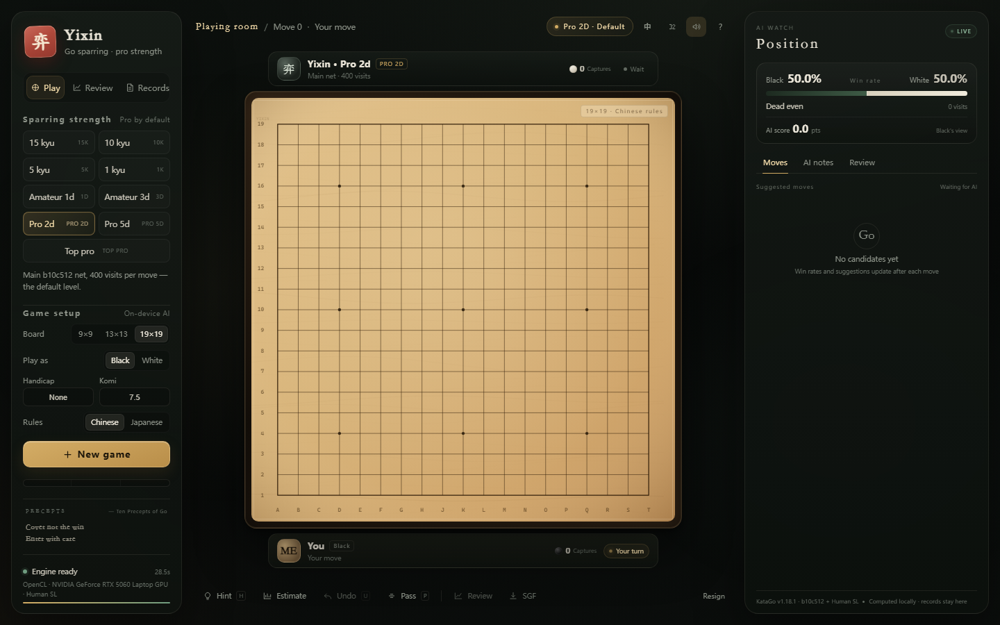
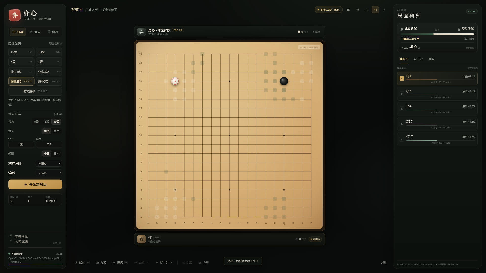

# 弈心 · 围棋陪练

**开箱即用的本地围棋陪练：打开浏览器就能和 KataGo 对坐，提示、形势、复盘全都实时算出来。**

不是脚本棋谱，不是云服务，不用注册账号。引擎、神经网络、棋谱全部留在你自己电脑上。

> **如果这个项目对你有用，点个 star 或 fork 一下** —— 小项目没有推广预算，这是让更多人看到它、也是让它继续维护下去的最直接帮助。无需注册、无遥测。

  
  
  
  

实机截图（Windows 11 / RTX 5060 Laptop / OpenCL）：19 路、职业二段默认档（b10c512，每手 400 次搜索），引擎就绪耗时见左下角。第三、四张是 AI 提示（A/B/C 候选点）与形势判断。右上角可切中英文，也可以用 <code>?lang=en</code> 直接进英文界面。

---

## 这是什么

弈心是一个 **Windows 本地围棋陪练工具**：后端是纯 Python 标准库的小服务，前端是一块自己画的 Canvas 棋盘，中间连着你本机的 KataGo 分析引擎。

它对标的是「想认真下棋，但不想联网、不想被 AI 平台抽成、不想装一堆依赖」的那批人：

- 想练棋，但免费 AI 平台有次数限制、收费 AI 要订阅；
- 想复盘，但把棋谱传上去总觉得别扭；
- 想要一个能调强度、能看候选点、能随时悔棋的陪练，而不是一个冷冰冰的引擎命令行。

打开一次，之后全程离线可用。

## 60 秒开始

1. 到 [Releases](https://github.com/Qin-Z-x/yixin-go/releases/latest) 下载 `Yixin-Go-Sparring-*-portable.zip`，解压到任意目录（**不要**放在中文路径或受保护的 `Program Files` 下）。
2. 双击 `启动围棋陪练.bat`。
3. 等 10–30 秒，引擎完成 GPU 预热，Edge 会以应用窗口打开棋盘。

默认执黑、19 路、中国规则。落子后 AI 自动应手。

> 第一次运行某个模型 × 显卡组合时，KataGo 会做一次 OpenCL 调优，可能需要几分钟；之后启动通常十几秒。
> 退出：右上角 `?` → 「退出程序」，或双击 `停止围棋陪练.bat`。

**从源码跑**：需要 Python 3.10+ 和本机 KataGo，详见 [docs/BUILD.md](docs/BUILD.md)。

## 陪练强度

| 档位 | 引擎配置 | 适合谁 |
| --- | --- | --- |
| 15级 / 10级 / 5级 / 1级 | b18 Human SL | 入门到进阶，按人类落子分布行棋，不会突然下出 AI 怪招 |
| 业余1段 / 业余3段 | b18 Human SL | 有段位基础，想练中盘战斗与官子 |
| **职业2段（默认）** | b10c512，400 visits | 想被压着打的日常陪练档 |
| 职业5段 | b10c512，800 visits | 复杂战斗、死活攻防 |
| 顶尖职业 | b10c512，1600 visits | 接近 KataGo 实战强度，用来找差距 |

几点说明，免得误会：

- 这些是 **引擎配置档位的名字**，不是通行证。档位由「模型 + 每手搜索量（visits）」决定，不是预置棋谱——每一手都是实时 MCTS 搜出来的。
- 档位参数取自 KataGo 官方对搜索量与棋力关系的经验值。如果你需要一个**正式**的棋力评级，请用 KataGo 官方 rating 工具，或参加受认证的评测；本软件的档位名不能当段位证书用。
- 每手耗时取决于显卡。作者本机 RTX 5060 Laptop + OpenCL 实测：400 visits 约 2–4 秒/手，800 visits 约 4–7 秒，1600 visits 约 8–15 秒。核显会明显更慢。

## 功能

- **对弈**：19 / 13 / 9 路，中国 / 日本规则，执黑执白，让 2–9 子，贴目可调；可选 5–60 分钟主时间，并可选 30/60 秒 × 3 次读秒，双方时钟独立，时间用尽即超时判负。
- **AI 提示**：按 `H`，右侧给出 A/B/C 三个候选点的胜率、目差和变化图——可以直接用来对答案。
- **形势判断**：一键显示 KataGo 的地盘归属和目差预测，点第二次关闭。
- **死活数子**：双方停一手后自动标记死子，点棋子可手动增删，确认即终局。
- **AI 复盘**：终局后逐手分析：胜率损失曲线、好棋 / 失误标记、AI 首选与变化图，点曲线或棋谱任意一手都能跳回去看。
- **棋谱库**：结束的对局自动归档到 `data/games/`；可以直接载入旧棋谱重新复盘，也可以导入野狐 / 弈星 / OGS 等工具导出的 SGF 主线；支持搜索段位/结果/日期，按最新/手数/结果排序，按黑胜 / 白胜 / 9·13·19 路筛选，一键复制或下载 SGF，也支持查看棋谱详情、单条删除、勾选批量删除和放弃未完成对局。
- **统计**：棋谱库显示总局数、黑白胜负、平均手数，以及最常下的档位。
- **悔棋与重做**：悔棋撤回你和 AI 各一手，重做可以恢复悔棋前的局面，误操作不必重下。
- **翻转棋盘**：右上角翻转按钮可从白棋视角看棋盘，坐标、棋子、提示和点击落点会一起翻转。
- **中断续弈**：每一步都会把未完成对局保存到 `data/active/`。关掉程序或服务重启后，从「棋谱」→「未完成对局」点「继续」即可接着下，AI 也会接着应手。
- **复盘报告**：一键导出 Markdown 复盘报告（平均损失、关键失误、逐手表），方便存档或分享。
- **本地自检**：帮助面板里的「运行诊断」会检查引擎、主模型、Human SL 模型、配置和棋谱目录，并给出一键复制的诊断信息；棋谱库还会显示黑胜 / 白胜 / 平均手数统计。
- **纯本地**：不发任何请求到云端，断网也能下。
- **异常自恢复**：引擎意外退出会自动重启；正在等待的 AI 应手会在引擎恢复后自动重算（最多重试 2 次），并显示更准确的退出原因。
- **窄窗口适配**：1024px 左右窗口下操作栏自动换行；更窄窗口下等级列表改为两列，按钮和棋谱区域不会横向溢出。

## 和别的 AI 围棋工具比

| | 弈心 | 在线 AI 平台 | Sabaki / Lizzie 一类 |
| --- | --- | --- | --- |
| 运行方式 | 本地 exe + 浏览器界面 | 网页 | 本地桌面程序 |
| 内置可直接对弈的 AI | ✅ 开箱即用 | ✅ 但受限/收费 | ⚠️ 需自己配引擎 |
| AI 提示 / 形势 / 复盘 | ✅ 内置同一引擎 | 部分 | ✅ 但要自己调 |
| 人类风格强度档 | ✅ Human SL 6 档 | 少见 | 少见 |
| 需要注册 / 联网 | ❌ | ✅ | ❌ |
| 源码可改 | ✅ MIT | ❌ | 多为 MIT/GPL |

Sabaki、Lizzie 都是很成熟的棋盘与分析师工具，功能比弈心全面得多——弈心的取舍是**把"能直接下、能直接复盘"这条最短路径做到零配置**，不追求做成通用 SGF 编辑器。

## 快捷键

| 按键 | 功能 |
| --- | --- |
| `H` | AI 提示（A/B/C 候选点） |
| `U` | 悔棋 |
| `Y` | 重做 |
| `P` | 停一手 |
| `E` | 形势判断 |
| `N` | 新对局 |
| `R` | 复盘 / 返回对局 |
| `←` `→` | 复盘时上一手 / 下一手 |
| `?` | 帮助 |
| `Esc` | 关闭弹窗 |

## 技术细节

- **后端**：纯 Python 标准库 `ThreadingHTTPServer`，零 Web 框架、零第三方依赖。
- **引擎**：KataGo `analysis` JSON 协议，OpenCL 后端；同一进程同时加载主模型与 Human SL 模型，按档位切换。
- **前端**：原生 Canvas 绘制棋盘，高 DPI 自适应，木纹与棋子程序生成，无外部图片、无 CDN、无 Web 字体。
- **并发**：对弈、预分析、复盘、数子分属独立线程，引擎内部有请求队列与优先级，复盘不会卡住当前对局。
- **规则**：中国规则面积计分，日本规则地域 + 提子；让子棋白棋不额外加让子补偿。
- **持久化**：未结束对局写入 `data/active/<id>.json`，结束时归档到 `data/games/`；载入棋谱会重建棋盘并可直接复盘。
- **SGF**：内置主线导入器，支持常见 `SZ/KM/RU/HA/AB/AW/PL/RE` 与 B/W 落子；变化图会被跳过，保留主线。

## 运行要求

- Windows 10 / 11（x64）。
- 一块支持 OpenCL 的显卡（NVIDIA / AMD / Intel 核显都可以，NVIDIA 独显体验最好）。
- 约 250 MB 磁盘（含引擎与两个神经网络模型）。

## 常见问题

**首次启动很慢？** KataGo 在第一次用某个模型时会做 OpenCL 调优，缓存到 `engine/katago-opencl/KataGoData/opencltuning/`，之后启动十几秒。

**提示「引擎异常」？** 用 `调试启动.bat` 看控制台。常见原因：显存被占满、杀软拦截 `katago.exe`、模型文件不完整。关掉占显存的程序，点左下角引擎卡片可重启引擎。

**浏览器没自动打开？** 手动访问 `http://127.0.0.1:8765`。端口被占用时会自动尝试 8766–8784，控制台会打印实际地址。

**棋谱在哪？** `data/games/`，同时存 JSON（含 SGF 文本）和可下载的 SGF；未完成对局在 `data/active/`，重启后可从「棋谱」继续。

**能导入 SGF 吗？** 能。打开「棋谱」→「导入 SGF」，选择 `.sgf` 文件。当前导入器读取第一棵 game tree 的主线；带复杂变化图的棋谱会保留主线、跳过分支。

**能导出复盘吗？** 能。终局并完成 AI 复盘后，右侧复盘面板底部点「导出复盘报告」，下载 Markdown 文件。

**能离线吗？** 能。模型和引擎都在本地，对局、提示、复盘都不需要网络。

## 许可证与致谢

本项目代码以 **MIT** 许可发布，见 [LICENSE](LICENSE)。

随包分发的 **KataGo 引擎同样是 MIT 许可**：其仓库根目录的 LICENSE 覆盖本体代码，`cpp/external/` 下的若干第三方库（CLBlast、cutlass、onnx 等）各自保留原有许可，详见上游仓库。两个神经网络模型由 KataGo 项目通过官方 Release 页面分发，本项目原样打包、不做修改。再分发便携版时请保留 [THIRD_PARTY_NOTICES.md](THIRD_PARTY_NOTICES.md) 以及 KataGo 的 LICENSE 文本（本仓库 `third_party/KataGo-LICENSE.txt` 有一份副本）。

- [KataGo](https://github.com/lightvector/KataGo) — David J. Wu 与贡献者，MIT。没有它这个项目不存在。
- [Sabaki](https://github.com/SabakiHQ/Sabaki)、[Lizzie](https://github.com/featurecat/lizzie) — 棋盘与 AI 复盘交互上的前辈，很多设计思路来自它们。
- Python、PyInstaller 各自遵循其许可证。

## 相关项目（同一作者，互相独立、标准库优先）

同一作者的其他开源项目，各自独立、能力边界写在各自的 README 里：

- [llm-failbench](https://github.com/Qin-Z-x/llm-failbench) —— 面向 LLM 的确定性失败探针：10 类 100 条、免评审、可进 CI 门禁 + 带引用的失败案例库。
- [llm-json-doctor](https://github.com/Qin-Z-x/llm-json-doctor) —— LLM 坏 JSON 的确定性修复 + JSON Schema 校验；不调模型、标准库实现。
- [llm-invisible-guard](https://github.com/Qin-Z-x/llm-invisible-guard) —— 不可见 Unicode（零宽/双向控制/标签走私）提示注入检测与清洗。
- [llm-exfil-guard](https://github.com/Qin-Z-x/llm-exfil-guard) —— 渲染输出外带检测：图片信标、隐藏内容、远程加载。
- [slopsquat-guard](https://github.com/Qin-Z-x/slopsquat-guard) —— 幻觉/仿冒包名校验：安装前查 PyPI / npm 依赖名是否存在、是否近似热门包。
- [regex-redos-guard](https://github.com/Qin-Z-x/regex-redos-guard) —— LLM 生成正则的 ReDoS（灾难性回溯）风险检测，静态规则 + 超时实测。

如果你只想要其中一个，直接 fork 即可，不需要整套一起用。

## 参与

- 想加功能？先看 [ROADMAP.md](ROADMAP.md) 里"明确不做"的部分，避免白写。
- 提 Issue 前先看一遍 [CONTRIBUTING.md](CONTRIBUTING.md)。
- 交流请遵守 [CODE_OF_CONDUCT.md](CODE_OF_CONDUCT.md)——只有一条要求：把话说清楚，对人客气。
- 改了界面、修了 bug、补了文档都欢迎 PR。

---

如果你也在找一个能安安静静陪你下棋、不下完就把棋谱传上云的东西，这个项目就是为你写的。
